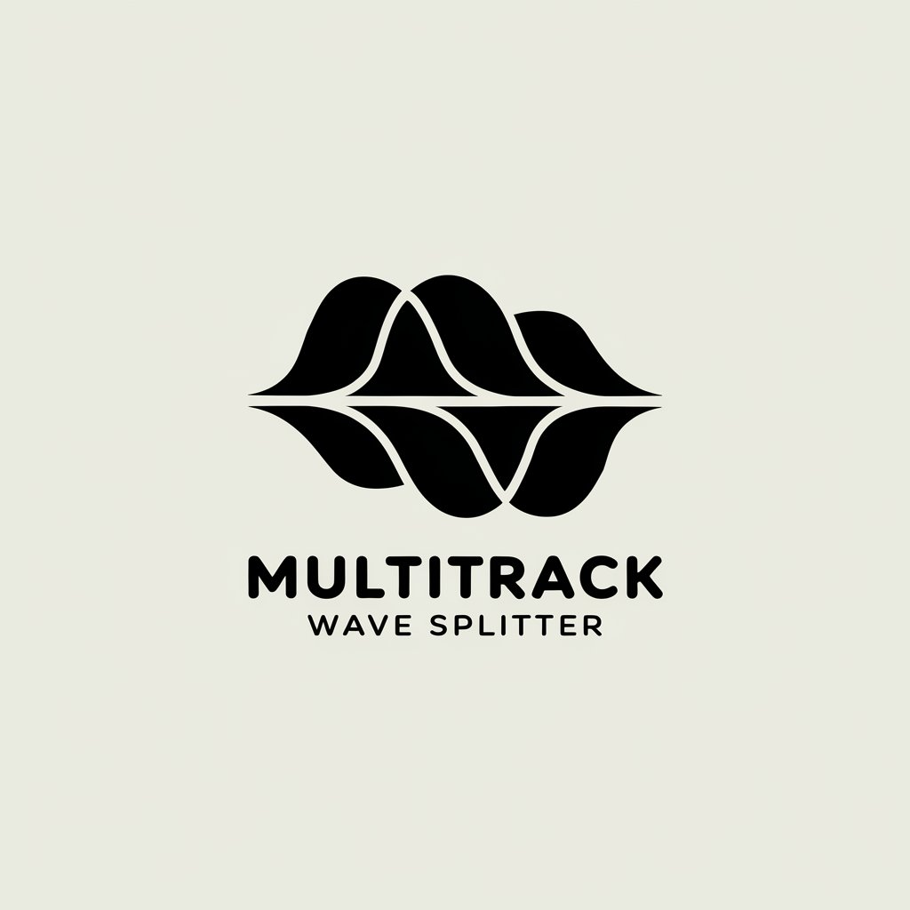

# Multitrack WAV Splitter

<p align="center">
  
</p>

Split a multitrack WAV file into individual mono WAV files. Useful when recording with a **Behringer X32** and the **X-Live** expansion card: the session is saved as one multitrack WAV on the SD card, but DAWs like **Studio One** expect one mono WAV per track. This tool does the split.

## Features

- **CLI tool** – Split multitrack WAV from the command line (single file or whole directory).
- **Batch directory mode** – Pass a folder of multitrack WAVs; each file is split automatically. Mono files are skipped.
- **Delete originals** – Optional `-delete-original` removes each source multitrack WAV after a successful split.
- **Versioned builds** – Semver in `internal/version/version.go`; printed on every run and via `-version`. Release tags build multi-platform binaries with Dagger/GitHub Actions.
- **Browser GUI (WASM)** – React app that runs the splitter in the browser via WebAssembly: drop a WAV file and download individual mono tracks.
- **PCM only** – Supports standard uncompressed PCM WAV (any channel count, common bit depths).
- **Interleaved format** – Correctly deinterleaves multichannel samples (Ch1-S1, Ch2-S1, … ChN-S1, Ch1-S2, …) into one mono file per channel.

## Installation

### From source

```bash
git clone https://github.com/bbu/multitrack-wav-splitter.git
cd multitrack-wav-splitter
go build -o mtwav-split ./cmd/mtwav-split
```

### Cross-compilation (Dagger)

Release binaries for common platforms (requires Docker + [Dagger](https://dagger.io)):

| OS | Architectures |
|----|----------------|
| Linux | `amd64`, `arm64`, `386`, `armv7` |
| Windows | `amd64`, `arm64`, `386` |
| macOS | `amd64` (Intel), `arm64` (Apple Silicon) |

```bash
# List targets
dagger call targets

# Tests + all binaries into ./dist
dagger call check --version=0.2.0 export --path=./dist

# Build only
dagger call build --version=0.2.0 export --path=./dist
```

CI ([`.github/workflows/ci.yml`](.github/workflows/ci.yml), Dagger **v0.21.10**):

- **Push / PR** (no version tag): runs tests only (`dagger call test`)
- **Version tag** (`v*`, e.g. `v0.2.0`): runs tests + cross-build and publishes a GitHub Release with the binaries

```bash
# After bumping internal/version/version.go + CHANGELOG
git tag -a v0.2.0 -m "v0.2.0"
git push origin v0.2.0
```

Local Makefile builds (host or selected targets) still work:

```bash
make build          # host binary → build/mtwav-split
make build-all      # common OS/arch → build/mtwav-split-<os>-<arch>
```
## Usage

```text
mtwav-split -input <file-or-dir> [-output <dir>] [-pattern <pattern>] [-delete-original]
mtwav-split -version
```

| Flag               | Description |
|--------------------|-------------|
| `-input`           | Path to a multitrack WAV **file** or a **directory** of WAV files (required). |
| `-output`          | Output directory for mono WAV files. Default: current directory (single file) or the input directory (batch). |
| `-pattern`         | Filename pattern; `%d` is replaced by the 1-based track number (default: `<inputname>_track_%03d.wav`). |
| `-delete-original` | After a successful split, delete the source multitrack WAV. Safe with batch: only deleted if that file split OK. |
| `-version`         | Print the version number and exit. |

On every run the CLI prints `mtwav-split <version>` first (e.g. `mtwav-split 0.2.0`). The same number is embedded into release binaries via `-ldflags` when building with Dagger or `make build`.

In directory mode, only top-level `*.wav` / `*.WAV` files are processed (no recursion). Files that are already mono are skipped with a message. For batch runs, leave `-pattern` empty so each source keeps a unique `<basename>_track_…` name.

### Examples

Print the version:

```bash
./mtwav-split -version
# 0.2.0
```

Split `session.wav` in the current directory:

```bash
./mtwav-split -input session.wav
# mtwav-split 0.2.0
# Split 32 tracks to .
```
Split into a specific folder with a custom naming pattern:

```bash
./mtwav-split -input /path/to/recording.wav -output ./stems -pattern "channel_%d.wav"
```

Split every multitrack WAV in a folder (e.g. X-Live SD card session):

```bash
./mtwav-split -input /Volumes/XLIVE/SESSION
```

Split a folder and delete the originals after success:

```bash
./mtwav-split -input ./recordings -delete-original
```

## Output

- One mono WAV per channel, same sample rate and bit depth as the source.
- Channel order matches the multitrack file (e.g. channel 1 → `track_001.wav`).

## Browser GUI (WASM)

A React app runs the splitter in the browser via Go-compiled WebAssembly. No server upload: the WAV is processed locally.

- **Performance note**: For large multitrack recordings, the **CLI is significantly faster and more robust** than the browser GUI. Prefer the CLI when splitting long X32/X-Live sessions, and use the GUI for convenience and smaller files.

### Build and run

1. **Build the WASM module and copy the Go runtime script:**

   ```bash
   make wasm
   ```

   This produces `web/public/mtwav-split.wasm` and copies `wasm_exec.js` from your Go installation into `web/public/`.

2. **Install dependencies and run the dev server:**

   ```bash
   cd web && npm install && npm run dev
   ```

   Open the URL shown (e.g. http://localhost:5173), drop a multitrack WAV file, then download the split mono files.

3. **Production build:**

   ```bash
   cd web && npm run build
   ```

   Serve the `web/dist/` directory with any static file server (e.g. `npx serve web/dist`).

### File size and streaming (browser)

- **Split in browser** (WASM): For files up to **400 MB**. The whole file is loaded into memory, so larger files will run out of memory.
- **Stream to folder**: For **files of any size** (including multi-GB), use **Stream to folder**. The app will ask you to choose an output directory (via the [File System Access API](https://developer.mozilla.org/en-US/docs/Web/API/File_System_Access_API)); the file is read and written in chunks, so memory stays bounded (tens of MB). Supported in **Chrome** and **Edge**. For Firefox or Safari, use the **CLI** for large files.

### Requirements

- Go 1.21+ (for building the WASM binary).
- Node.js 18+ (for the React app). `wasm_exec.js` is copied from `$(go env GOROOT)/lib/wasm/` or `misc/wasm/` depending on your Go version.

## Testing

```bash
go test ./...
```

## License

CC0 1.0 Universal. See [LICENSE](LICENSE).

## Roadmap

- Optional: “Download all as ZIP” in the browser GUI.

## Versioning & releasing

- Source of truth: `internal/version/version.go` (`Version`, no leading `v`).
- Changelog: `CHANGELOG.md`.
- Local check: `./mtwav-split -version` or any split run (prints `mtwav-split <version>`).

To publish a release:

1. Bump `Version` in `internal/version/version.go` and update `CHANGELOG.md`.
2. Commit, then tag and push:

```bash
git tag -a v0.2.0 -m "v0.2.0"
git push origin v0.2.0
```

GitHub Actions (Dagger) runs tests, cross-compiles all platforms with that version baked in, and creates a GitHub Release with the binaries.
